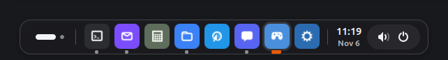
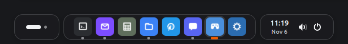
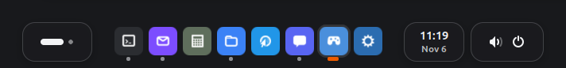

# Silver Dock

A dock for GNOME Shell 46 to 50, on Wayland and X11. At the bottom or top it also
holds the top bar's menu, clock, tray and system menu.

<p align="center">
  
  <br><sub>Silver</sub>
</p>
<p align="center">
  
  <br><sub>Silver with islands</sub>
</p>
<p align="center">
  
  <br><sub>Float</sub>
</p>

## Features

- Any screen edge, on one monitor or all. On the left or right the top bar keeps its content, optionally in the dock's look
- Dock look, an own color, the wallpaper's or the shell and GTK theme's colors, optionally tinted app icons. The wallpaper behind the bar blurred, the app in front on a soft tile
- Two designs: Silver Dock's own, and floating, where the icons stand free on the desktop and only the menu button, the clock and the tray sit on chips of their own
- Both mark the focused app in the system accent (GNOME 47 and later) and show the time over the date. Silver Dock puts the tray on a soft pill, optionally the menu button, the apps and the clock with the tray sit on separate islands
- Both designs light or dark: as the design has it, fixed, or following the system's dark style
- Hover styles magnify, ripple, lift, lift and grow, or none
- Icons pop in and out, squash on click, rise in a wave after login, bounce until a starting app shows its window and wiggle when it asks for attention. Window dots glide, badges pop, windows minimize into their icon, top bar buttons lift, the ArcMenu button takes off
- Window dots, app names on hover, the app menu on right click. Left and middle click do what you pick, previews of several windows by default. Scrolling over an icon switches its windows, on a free spot the workspaces
- Right click on a free spot for the settings. Ctrl+Alt+Tab reaches the icons, the arrow keys move along, the Menu key opens the app menu
- Window previews on hover, resting on one shows only that window
- Drag to rearrange, pin and unpin, an unpinned app goes up in a little cloud
- Badges and progress bars (Unity LauncherEntry), the notification count for apps without their own
- Media controls in the right click menu of apps that play something (MPRIS)
- Trash and drives with open, empty and eject
- Over a fullscreen window the bar stays out of the way. The ArcMenu key brings it along, after a click on the bar it stays for the volume and the other menus until Escape or a click back into the window
- Separators, a soft shadow, autohide, opaque while a window touches the bar. A hidden bar comes back when the pointer pushes against the edge or an app asks for attention

Every extra can be switched off in the preferences.

## Install

Pack in this folder, the ZIP is named after `version-name` in `metadata.json`:

```
gnome-extensions pack --force --podir=po --extra-source=LICENSE $(ls *.js | grep -vE '^(extension|prefs)\.js$' | sed 's/^/--extra-source=/') .
mv silver-dock@simonlinuxcraft.github.io.shell-extension.zip silverdock-v$(sed -n 's/.*"version-name": "\(.*\)".*/\1/p' metadata.json).zip
```

Install it on the target machine:

```
gnome-extensions install --force silverdock-v*.zip
```

Log out and back in, then `gnome-extensions enable silver-dock@simonlinuxcraft.github.io`.
Switch other docks off (ubuntu-dock, dash-to-dock, dash-to-panel).

For development, link this folder instead:

```
ln -s "$PWD" ~/.local/share/gnome-shell/extensions/silver-dock@simonlinuxcraft.github.io
```

## Test

GNOME internals stay in `takeover.js` (`dock.js` only reads `_delegate` of menus), version
differences live in `compat.js`.

```
gjs -m test/layout-test.js   # hover math
gjs -m test/colors-test.js   # GTK theme colors
test/smoke.sh                # headless GNOME Shell: enable/disable, settings, prefs, demo apps
test/smoke.sh --show         # the same in a window (needs mutter-dev-bin)
test/gnome.sh [46..49]       # smoke.sh on GNOME 46 to 49 in podman, X11 too up to 48
```

The test shell has its own D-Bus and settings, the running session is not touched.
For a new GNOME release add it to `shell-version` in `metadata.json` and run the tests.

## Translations

`po/` holds the catalogs, `test/smoke.sh` compiles them into `locale/`. After changing texts:

```
xgettext --from-code=UTF-8 --language=JavaScript --keyword=_ --package-name=silver-dock -o po/silver-dock.pot dock.js places.js prefs.js
msgmerge --update po/de.po po/silver-dock.pot
```

A new language starts with `msginit -l <lang> -i po/silver-dock.pot -o po/<lang>.po`.

## License

GPL-2.0-or-later, see `LICENSE`.
